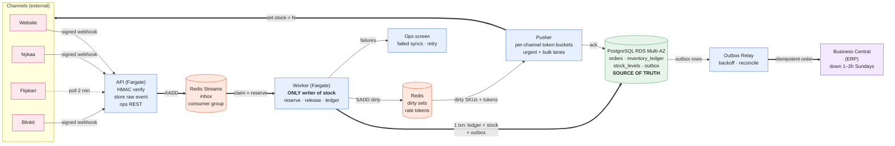

# Order & Inventory Sync Service — Design

**Mars Cosmetics · Engineering Assessment** · NestJS · PostgreSQL · Redis · AWS (ap-south-1)

---

## 1. Architecture

Last sale, Mars oversold ~900 units because two channel feeds each believed they held the last one. This design makes **warehouse stock the only thing anyone writes**, then mirrors it out to each channel as fast as that channel's limits allow. Channels are never sources of truth.


*Source:* [architecture.mmd](design/diagrams/architecture.mmd) · [SVG](design/diagrams/architecture.svg) · *PNG high-res:* [architecture.png](design/diagrams/architecture.png)

> **Core decision.** A reservation is one atomic Postgres statement — `UPDATE stock_levels … WHERE on_hand - reserved >= qty` against a per-SKU availability row — plus an idempotency key so it can be replayed safely. Overselling is prevented by a lock and an invariant, not by being fast enough. Ordering comes from Postgres rather than from the queue: sharding SKUs across consumers only moves the race, since every writer takes the same one-row lock anyway.



**What runs where.** `API` (2–4 Fargate tasks behind an ALB) validates and stores webhooks, never does business logic. `Worker` (2–4 tasks, one consumer group) is the only writer of stock. `Pollers`, `Pusher` and `Relay` are separate services so a dead ERP or a throttled channel cannot slow ingestion. Postgres is RDS Multi-AZ `db.t4g.medium`; Redis is ElastiCache `cache.t4g.small` holding *only* streams, dirty sets and rate-limit buckets — never the truth.

---

## 2. Data model

| Table | Key columns | Constraints that carry the design |
|---|---|---|
| `orders` | id, channel, external_order_id, state, payment_mode, total, pincode, erp_order_id | **`UNIQUE(channel, external_order_id)`** |
| `order_items` | order_id, sku, qty, unit_price | PK `(order_id, sku)` — no duplicated lines |
| `order_events` | channel, external_order_id, event_type, event_time, raw jsonb | **`UNIQUE(dedupe_key)`** |
| `inventory_ledger` | sku, delta_reserved, delta_on_hand, reason, source_type/id, actor, created_at | **`UNIQUE(idempotency_key)`**; append-only |
| `stock_levels` | sku PK, on_hand, reserved, available, in_transit | `available GENERATED (on_hand - reserved)`; `CHECK(on_hand >= reserved)` |
| `channel_stock` | channel, sku, pushed_qty, desired_qty, last_push_at, status, attempts | PK `(channel, sku)` |
| `outbox` | order_id, payload, idempotency_key, status, attempts, next_attempt_at | **`UNIQUE(idempotency_key)`** |
| `failed_syncs` | kind, ref, error_class, attempts, state, resolved_by | backs the ops screen |

The ledger is the audit trail and the source of truth. `stock_levels` is a materialised row updated in the **same transaction** — not a `SUM()` over the ledger at read time, which would make every SKU hot. A nightly job re-sums the ledger and alerts on drift.

**Duplicates die at three layers**, because each covers a failure the others don't: `order_events.dedupe_key` stops an event being processed twice; `orders` uniqueness stops the same order arriving via webhook *and* poll; and `inventory_ledger.idempotency_key` stops a **stock movement** applying twice if an order is ever reprocessed — the one that matters, because the ledger insert, not the order row, gates the counter update.

---

## 3. Order ingestion

**Website & Blinkit.** Verify HMAC, write `order_events`, return `200`, process async. No business logic in the handler — handler timeouts are the main cause of duplicate storms.

**Nykaa — duplicates and out-of-order.** Duplicates die on `dedupe_key`. A per-order state machine ordered by `event_time` (or `source_seq`) handles sequence; a backwards transition (`CREATED` after `CANCELLED`) becomes a zero-delta `RECONCILIATION` ledger row raised in failed syncs. No "create then release": the buyer is gone, so reserving then freeing is a phantom hold and a second race.

**Flipkart — polling.** We assume neither deltas nor full snapshots: each poll is stored as a `(poll_id, order_id, status)` snapshot and **diffed per order** against the last, which also catches *disappearances* (a cancel that stops being listed). A failed cycle restarts from the same point, so an hour of downtime is one catch-up diff, not a hole.

**Channel down.** Each channel has its own queue and circuit breaker; ingest keeps accepting and buffering. The only thing never allowed to back up ingest is the ERP, and the outbox removes that risk entirely.

**Volume.** Peak 300 orders/min ≈ 5/s ≈ ~15 lines/s — a handful of single-row updates. One worker suffices; we run 2–4 for HA. Difficulty here is contention and fan-out, not throughput.

---

## 4. Inventory consistency — two channels sell the last unit in the same second

`MRS-LIP-104` sits at `on_hand = 1, reserved = 0, available = 1`. Nykaa and Flipkart each receive an order for 1 unit in the same instant.

1. **Both events persist.** Webhook and poller each insert `order_events`. No stock is touched.
2. **Each worker runs one transaction**, locking SKU rows in sorted order (prevents deadlocks on multi-SKU carts):

   ```sql
   BEGIN;
   INSERT INTO inventory_ledger (sku, delta_reserved, reason, source_type, source_id, idempotency_key)
   VALUES ('MRS-LIP-104', 1, 'ORDER_RESERVED', 'ORDER', $order,
           'ORDER_RESERVED:ORDER:' || $order || ':MRS-LIP-104')
   ON CONFLICT (idempotency_key) DO NOTHING RETURNING id;   -- none => duplicate, skip
   UPDATE stock_levels SET reserved = reserved + 1, updated_at = now()
    WHERE sku = 'MRS-LIP-104' AND on_hand - reserved >= 1;  -- 0 rows => ROLLBACK
   COMMIT;
   ```

3. **Postgres decides.** The `UPDATE` takes the row lock and re-evaluates the predicate against the current row; the `CHECK` is a second net. One order wins (`available = 0`); the other blocks for microseconds and correctly fails. **This is the moment overselling is prevented** — not in Redis, not in a retry.
4. **The loser goes to the allocation lane, not straight to cancellation.** Retry once; if still empty — on the **website**, fail or refund at checkout (we control that experience); on a **marketplace**, cancel, notify the channel, increment `oversell_blocked`. That is exactly the brief's 0.5 % metric.
5. **Same transaction** writes the `outbox` row and marks the SKU dirty. Rollback means neither exists: "will be invoiced" and "channels will be told" commit together.

**No lock fixes the stale channel mirror.** Nykaa may show 1 while we hold 0 because the push is in flight — the propagation race that caused the 900-unit loss. We bound it with a priority lane plus a small buffer: website 0 % (stock is checked at checkout), Flipkart 2–3 %, Nykaa 5 % on sale days, Blinkit 2 % plus its API for low-stock SKUs. The buffer **caps how much a slow channel may over-show**; it is not a throttle. **Release before push**: stock leaves a channel only after the release commits.

---

## 5. Stock push — four channels, one 60-second promise, very different limits

**Honest arithmetic.** Nykaa at 5 req/s is 300 calls/min, so a full 1,200-SKU sweep takes **240 s**; a full-refresh-everything-in-60 s promise there is impossible. What we commit to is: **every SKU whose stock changed is pushed within 60 s**, plus a **full sweep every ≤ 5 min**. Flipkart's whole catalog is 24 calls at 9 req/s ≈ 3 s, so it is never the bottleneck. Blinkit gets the daily CSV plus API calls for urgent changes.

1. **Dirty set.** Every commit does `SADD dirty:{channel} sku` — O(1), off the critical path.
2. **Priority lanes.** Low-stock and recently-ordered SKUs: debounce 1–2 s, first in line. Everything else: debounce 10 s. When urgent saturates, bulk waits; nothing is dropped because of the sweep.
3. **Token buckets in Redis**, shared by pusher instances, refilled at 90 % of the limit (Nykaa 4.5/s, Flipkart 9/s) so we rarely approach 429. Per channel, never global.
4. **Absolute values only** (`set to N`, never `−1`), so retries and out-of-order APIs are harmless; write-latest-wins.
5. **The safety net lives in Postgres, not Redis**: every 5 min re-send SKUs whose `updated_at` is newer than their last acked `push_at`. A Redis restart costs the dirty set, not correctness.
6. **429 / timeouts** → `Retry-After` if present, else exponential backoff with jitter per channel. Blinkit's 2 % timeouts are simply retried next cycle.

**Can we hold 300 changed SKUs/min?** Yes: a hot SKU ships in ~1–2 s and the urgent lane at 4.5/s absorbs 270 pushes/min, so low-stock SKUs never queue behind healthy ones. Past that, we drop the debounce and batch low-risk SKUs; the buffer absorbs the gap. The limit is documented and alerted, not hidden.

---

## 6. Failure handling

| Failure | Behaviour | Why it's safe |
|---|---|---|
| **ERP down 1–2 h (Sunday)** | Orders keep flowing; `outbox` commits with the reservation. The relay backs off, rows stay `PENDING`, and \~36k rows (300/min × 120) drain in \~12 min on recovery. | No lost orders; stock was reserved before BC saw them, so nothing oversells meanwhile. |
| **"Exactly once" to ERP** | We promise **at-least-once + reconciliation**, and say so: exactly-once across an HTTP boundary isn't achievable on our side alone. Deterministic payload, key `erp:{channel}:{external_order_id}`, and a `GET` by `externalDocumentNo` before retrying an unknown-outcome timeout. The residual window is the Sunday retry; the ERP team must provide insert-if-absent on that field. | Names the dependency instead of pretending. Fallback: nightly "one open document per order" reconciliation. |
| **Blinkit timeouts (2 %)** | Retry with jitter; after 3 attempts mark `TIMEOUT`; > 15 min raises a failed sync. | Absolute-set pushes are idempotent. |
| **Flipkart 429** | 9/s target avoids it; on 429 honour `Retry-After`, retry, never drop. | Per-channel isolation. |
| **Poison messages** | 8 attempts, then `failed_syncs` **in the same transaction that acks**. Ops fixes the cause and retries with the original key. | Retry is idempotent; nothing lost between ack and capture. |
| **Worker crash mid-reservation** | Entry not acked; `XAUTOCLAIM` after 60 s idle (longer than max handler time) reclaims it; the ledger key makes replay a no-op. | The Postgres constraint is the barrier; Redis dedupe is only a cache. |

Nothing retries forever; anything that stops retrying is a row on the **Failed syncs** screen, grouped by kind, with one-click retry.

---

## 7. Observability — day one

1. **Channel cancellations attributed to stock**, per channel per hour — from marketplace cancel reasons *and* our own oversell cancels. Our internal counter alone would look green while the marketplace cancels on our behalf. Alert > 0.3 %.
2. **Channel stock age (p95, per channel)** for SKUs whose stock changed. Alert > 60 s normal; > 5 min max on Nykaa during a sale.
3. **ERP backlog age** (oldest `PENDING`), alert > 30 min outside the Sunday window — age, not size, avoids Sunday noise.
4. **Oversell blocks + insufficient-stock rate** — a spike is a bug (e.g. a missed return); a slow rise is demand outrunning supply.
5. **Ingest consumer lag + open failed syncs by age** — is the pipeline alive, and what needs a human now.

Plus a synthetic canary per channel: push one SKU and read it back every 5 min. It catches "API said 200 but didn't apply it", which no internal metric sees.

---

## 8. Scope — out of v1, and why

**Multi-warehouse allocation** (one warehouse is stated; stretch A covers it) · **refunds/credit notes** (ERP owns money; we only move stock) · **catalog and price sync** · **a full inventory console** (ops need failed syncs + retry first) · **LLM analytics** (the ledger is already queryable) · **Kafka, a separate inventory service, Debezium, a search cluster** (cost and operational surface three developers don't have for a 5-orders/s problem) · **multi-region** (Multi-AZ is the right 6-week posture).

---

## 9. Assumptions, trade-offs, stretch

- **Assumptions** (auth, PII, ERP idempotency, returns-as-`in_transit`, the 60 s reading, cost build-up): [ASSUMPTIONS.md](ASSUMPTIONS.md).
- **Trade-offs** — six decisions × chose/rejected/why, in full: [TRADEOFFS.md](TRADEOFFS.md). In brief: Postgres row lock over optimistic retry (retries collapse under hot-SKU load); ledger + materialised row over Redis-as-truth (audit trail and ERP intent live in one transaction); Redis Streams over Kafka at 5 orders/s; transactional outbox + pre-retry existence check over 2PC with BC; absolute channel writes over deltas; a small documented buffer over blocking sales until all channels ack.
- **Stretch A** (second warehouse): [STRETCH.md](STRETCH.md) — stock becomes `(sku, warehouse_id)`, allocation by pincode zone, channels see `SUM(available)`, ERP stays a passive sink.
- **AI usage:** [AI_USAGE.md](AI_USAGE.md).
- **Reservation pseudo-code:** [RESERVATION_PSEUDOCODE.md](RESERVATION_PSEUDOCODE.md).
