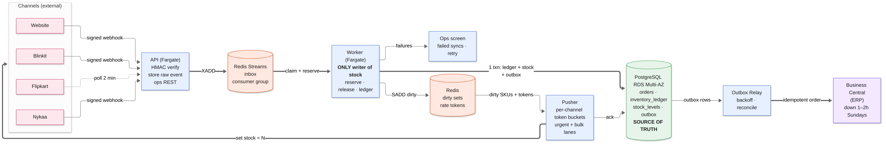

# Order & Inventory Sync Service

Mars Cosmetics · NestJS · PostgreSQL · Redis · AWS



---

## Data model

`orders(id, channel, external_order_id, state, payment_mode, total, pincode, erp_order_id)` — `UNIQUE(channel, external_order_id)`.
`order_items(order_id, sku, qty, unit_price)` — PK `(order_id, sku)`.
`inventory_ledger(sku, delta_reserved, delta_on_hand, delta_in_transit, reason, source_type, source_id, created_at)` — `UNIQUE(idempotency_key)`. Append-only; this is the audit trail.
`stock_levels(sku PK, on_hand, reserved, in_transit)` — `available` is a stored generated column; `CHECK(on_hand >= reserved)`.
`channel_stock(channel, sku, pushed_qty, last_push_at, status)` — what each channel currently shows.
`outbox(order_id, payload, idempotency_key, status, attempts, next_attempt_at)` — `UNIQUE(idempotency_key)`.
`failed_syncs(kind, ref, error_class, attempts, state)` — backs the ops screen.

**Duplicates.** `(channel, external_order_id)` on `orders` stops the same order arriving twice (webhook *and* poll). `idempotency_key = "{reason}:{order_id}:{sku}"` on the ledger stops a stock movement applying twice if an order is reprocessed — the one that matters, since the ledger insert, not the order row, is what gates the counter update.

---

## Ingestion

Webhooks verify HMAC, return 200 immediately, and hand off to a Redis Stream. No business logic in the handler; handler timeouts are what cause duplicate storms.

**Nykaa** sends duplicates and out-of-order events. Duplicates die on the unique key. A per-order state machine ordered by `event_time` handles sequence; a `CREATED` arriving after a `CANCELLED` is written as a zero-delta ledger row and flagged, never reserved. The buyer is gone, so reserving and freeing stock creates a phantom hold and a second race.

**Flipkart** is poll-only. We store each poll as `(poll_id, order_id, status)` and diff consecutive snapshots, which also catches a cancel that simply stops being listed. A failed poll retries from the same point, so an hour of downtime is one catch-up, not a gap.

Each channel has its own queue and circuit breaker, so one channel being down affects only itself.

---

## Inventory consistency

`MRS-LIP-104` has `on_hand = 1, reserved = 0`. Nykaa and Flipkart each receive an order for 1 unit at the same instant.

Both workers run this, inside one transaction per order, with SKU rows locked in sorted order:

```sql
WITH ledger AS (
  INSERT INTO inventory_ledger
    (sku, delta_reserved, reason, source_type, source_id, idempotency_key)
  VALUES ($2, $3, 'ORDER_RESERVED', 'ORDER', $1, $1 || ':' || $2)
  ON CONFLICT (idempotency_key) DO NOTHING
  RETURNING id
)
UPDATE stock_levels
   SET reserved = reserved + $3, version = version + 1, updated_at = now()
 WHERE sku = $2
   AND on_hand - reserved >= $3
   AND EXISTS (SELECT 1 FROM ledger)
RETURNING sku, (on_hand - reserved) AS available_after;
```

The `UPDATE` is atomic: it takes the row lock, re-checks the predicate against the locked row, and returns nothing if stock ran out. One order wins; the other blocks for microseconds and fails. `CHECK(on_hand >= reserved)` is a second net. This is where overselling is prevented — not in Redis, not by a retry.

The loser goes to an allocation lane: on the website we fail or refund at checkout, since we control that experience; on a marketplace we cancel, notify the channel, and count it against the 0.5% SLO.

The other half of the problem is that **the channel's mirror is stale, and no lock fixes that**. Nykaa may still show 1 while we hold 0. We bound it with a small buffer — website 0%, Flipkart 2–3%, Nykaa 5% on sale days — and by releasing stock only after the release commits.

---

## Stock push

Nykaa at 5 req/s is 300 calls/min, so a full 1,200-SKU sweep takes 240s. Full refresh inside 60s is impossible there. What we commit to: **every SKU whose stock changed is pushed within 60s**, plus a full sweep every 5 minutes. Flipkart's whole catalog is 24 calls at 9 req/s, so it is never the bottleneck.

Every commit adds the SKU to a dirty set. The pusher sends **absolute values** (`set to N`, never `-1`) so retries are harmless, urgent (low-stock) SKUs first, through per-channel token buckets at 90% of the documented limit. The safety-net sweep is driven by `updated_at` in Postgres, not by Redis, so a Redis restart costs us nothing but time. 429s and timeouts back off per channel.

---

## Failure handling

| Failure | Handling |
|---|---|
| ERP down 1–2h Sundays | The `outbox` row commits with the reservation. The relay backs off and drains the backlog on recovery — ~36k rows from a two-hour peak, about 12 minutes to clear. |
| "Exactly once" to ERP | Not achievable across HTTP from our side alone. We do at-least-once with a deterministic payload, a stable key `erp:{channel}:{external_order_id}`, and a `GET` by `externalDocumentNo` before retrying a timeout. Needs BC to enforce uniqueness on that field — see assumptions. |
| Blinkit timeouts (2%) | Retry with jitter next cycle. Pushes are idempotent. |
| Flipkart 429 | Honour `Retry-After`, exponential backoff, never drop. |
| Messages that keep failing | 8 attempts, then into `failed_syncs` in the same transaction that acks. Ops retries with the original key. |
| Worker crash mid-reservation | Not acked; `XAUTOCLAIM` after 60s. The ledger key makes the replay a no-op. |

---

## Observability

1. **Cancellations attributed to stock**, per channel per hour. Our own counter alone looks green while the marketplace cancels on our behalf — this one is the real 0.5% SLO.
2. **Stock age per channel** (p95) for changed SKUs. Alert above 60s.
3. **ERP backlog age** (oldest `PENDING`). Age, not size, so Sunday maintenance doesn't page anyone.
4. **Oversell blocks** — a spike is a bug, a slow rise is demand outrunning supply.
5. **Ingest lag and open failed syncs.**

Plus a canary per channel: push one SKU and read it back. Catches "API said 200 but didn't apply it", which no internal metric sees.

---

## Scope

Out of v1: multi-warehouse allocation (one warehouse is stated), refunds (ERP owns money), price/catalog sync, a full inventory console, LLM analytics, Kafka, a separate inventory service.

---

## Assumptions

- Webhooks are HMAC-signed per channel; credentials in Secrets Manager.
- Channels send `event_time` and, where possible, a sequence; otherwise we fall back to `received_at` and flag the order.
- **BC enforces uniqueness on `externalDocumentNo`** (or the ERP team de-dupes on their side). This is the one external dependency for "exactly once".
- Cancel releases stock immediately (nothing shipped); a return goes to `in_transit` and becomes `on_hand` only when the warehouse scans it.
- The 60s target means changed SKUs, not all 1,200 continuously.
- Single region, Multi-AZ. Budget ~₹50k/month all-in; estimate ~₹35k (Fargate ₹10k, RDS `db.t4g.medium` Multi-AZ ₹15k, ElastiCache ₹2.5k, ALB + S3 + logs ₹5k).

---

## Trade-offs

| Decision | Chose | Rejected | Why |
|---|---|---|---|
| Stock concurrency | Postgres row lock + conditional `UPDATE` + ledger idempotency key | Optimistic version-retry; Redis Lua as the stock authority | Retries collapse under hot-SKU contention at exactly the sale peak. Redis-as-truth can't commit the stock change, the ERP intent and the audit trail together. |
| Source of truth | Append-only ledger + a stored counter row, both in Postgres | Redis counter; `SUM(ledger)` on every read | The ledger answers "why did stock change"; the stored row keeps the lock narrow and reads cheap. |
| Transport | Redis Streams, one consumer group | Kafka/MSK; SQS per channel; processing inside the webhook | Streams give us consumer groups on infrastructure we already run. Kafka at 5 orders/s costs ₹15–20k and an ops burden. |
| ERP delivery | Outbox + idempotency key + pre-retry existence check | Fire-and-forget retries; 2PC with BC | 2PC with a third-party ERP isn't workable. At-least-once plus reconciliation is honest. |
| Channel writes | Absolute values, per-channel buckets | Delta pushes | Deltas double-apply on retry and break on out-of-order APIs. |

---

## Stretch A — second warehouse in Bengaluru

Stock becomes `(sku, warehouse_id)`. `channel_stock.desired_qty` becomes `SUM(available)` across warehouses. A new allocation step maps pincode to a preferred warehouse before reserving, falling back to the other one; orders split across warehouses become two ERP documents, so cancellation has to release the right lines. The subtle risk is that a channel sees the sum, which can be positive while no single warehouse has enough — allocation is checked before confirming.

No new infrastructure: `warehouse_id` on existing tables and a zone map, on the same Postgres.

---

## AI usage

DeepSeek coding agent drafted the document text and rendered the Mermaid diagram. The reservation approach and the trade-offs are my design decisions, and I can defend any part of this on the call.
